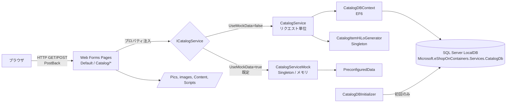

# 1. システム概要・アーキテクチャ（現行）

## 1.1 システムの目的

**[現行]** 商品カタログ（Catalog）を管理する社内向け管理画面「Catalog manager (Web Forms)」。
商品の一覧表示（ページング）、詳細表示、新規登録、編集、削除を提供する。
購買・カート・注文・ユーザー管理の機能は存在しない。

## 1.2 機能一覧

| ID | 機能 | 画面 | 概要 |
|---|---|---|---|
| F-01 | 商品一覧 | `Default.aspx` | 商品をページング表示（既定 10 件/ページ） |
| F-02 | 商品詳細 | `Catalog/Details.aspx` | 1 商品の全項目と画像を表示 |
| F-03 | 商品登録 | `Catalog/Create.aspx` | 商品を新規登録（画像は登録不可、既定画像） |
| F-04 | 商品編集 | `Catalog/Edit.aspx` | 既存商品を更新（画像名は変更不可） |
| F-05 | 商品削除 | `Catalog/Delete.aspx` | 確認画面を経て商品を削除 |
| F-06 | セッション情報表示 | `Site.Master` フッター | サーバーのマシン名とセッション開始日時を表示 |
| F-07 | 初期データ投入 | `CatalogDBInitializer` | DB 未作成時に DB・シーケンス・初期データを作成 |
| F-08 | モックデータモード | `CatalogServiceMock` | DB を使わずメモリ上のデータで動作（既定で有効） |
| — | About / Contact | `About.aspx`, `Contact.aspx` | テンプレートの静的ページ。どこからもリンクされていない |

## 1.3 技術スタック

| 区分 | 現行 | 根拠 |
|---|---|---|
| ランタイム | .NET Framework 4.7.2（`httpRuntime targetFramework="4.6.1"`） | `eShopLegacyWebForms.csproj`, `Web.config` |
| UI | ASP.NET Web Forms（Master Page, ListView, DropDownList, Validator 群） | `*.aspx` |
| ルーティング | `System.Web.Routing` の `MapPageRoute` | `App_Start/RouteConfig.cs` |
| DI | Autofac 4.9.1 + Autofac.Web（Web Forms のプロパティインジェクション） | `Global.asax.cs`, `Modules/ApplicationModule.cs` |
| データアクセス | Entity Framework 6.2.0（Code First、`CreateDatabaseIfNotExists`） | `Models/CatalogDBContext.cs` |
| DB | SQL Server LocalDB（`(localdb)\MSSQLLocalDB`） | `Web.config` |
| ロギング | log4net 2.0.10（ローリングファイル） | `log4Net.xml`, `Properties/AssemblyInfo.cs` |
| テレメトリ | Application Insights SDK 2.9.1（InstrumentationKey 未設定） | `ApplicationInsights.config`, `Web.config` |
| フロントエンド | Bootstrap 4.3.1, jQuery 3.5.0, popper.js, Modernizr, MS Ajax, Montserrat フォント | `packages.config`, `App_Start/BundleConfig.cs` |
| バンドル | `System.Web.Optimization` | `App_Start/BundleConfig.cs`, `Bundle.config` |
| セッション | InProc（`SessionStateModuleAsync`） | `Web.config` |
| ホスティング | IIS Express（`http://localhost:50586/`、SSL なし） | `eShopLegacyWebForms.csproj` |

## 1.4 アーキテクチャ

### レイヤー構成

| レイヤー | 構成要素 |
|---|---|
| プレゼンテーション | `Site.Master`, `Default.aspx`, `Catalog/*.aspx`（コードビハインドに画面ロジック） |
| サービス | `Services/ICatalogService.cs`, `CatalogService.cs`, `CatalogServiceMock.cs` |
| モデル / データ | `Models/*.cs`, `Models/CatalogDBContext.cs`, `Models/CatalogItemHiLoGenerator.cs` |
| 初期化 | `Models/Infrastructure/CatalogDBInitializer.cs`, `PreconfiguredData.cs`, `*.Sequence.sql`, `Setup/*` |
| ビューモデル | `ViewModel/PaginatedItemsViewModel.cs` |

### DI 登録（`Modules/ApplicationModule.cs`）

| 型 | ライフタイム | 備考 |
|---|---|---|
| `ICatalogService` → `CatalogServiceMock` | SingleInstance | `UseMockData=true` 時 |
| `ICatalogService` → `CatalogService` | InstancePerLifetimeScope（≒リクエスト） | `UseMockData=false` 時 |
| `CatalogDBContext` | InstancePerLifetimeScope | |
| `CatalogDBInitializer` | InstancePerLifetimeScope | |
| `CatalogItemHiLoGenerator` | SingleInstance | ID 採番の状態を保持 |

各ページは `public ICatalogService CatalogService { get; set; }` を公開し、Autofac の `PropertyInjectionModule` で注入される。

## 1.5 起動シーケンス（`Global.asax.cs`）

1. `Application_Start`
   1. ルート登録（`RouteConfig.RegisterRoutes`）
   2. バンドル登録（`BundleConfig.RegisterBundles`）
   3. DI コンテナ構築（`UseMockData` で実装を切替）
   4. `UseMockData=false` の場合のみ `Database.SetInitializer(CatalogDBInitializer)` を設定。DB の作成・シードは最初の DB アクセス時に実行される
2. `Session_Start`: セッションに `MachineName`（`Environment.MachineName`）と `SessionStartTime`（`DateTime.Now`）を保存
3. `Application_BeginRequest`: log4net の論理スレッドプロパティ `activityid`（相関 ID）と `requestinfo`（URL + UserAgent）を設定し、Debug ログを出力

## 1.6 認証・認可

**[現行]** 認証・認可は一切ない。全画面・全操作を匿名ユーザーが実行できる。
