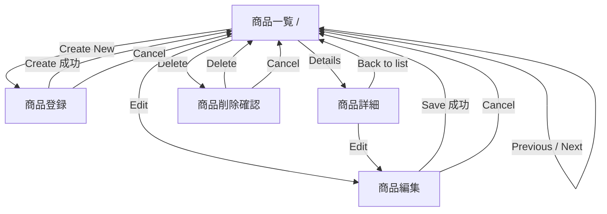

# 2. 画面仕様（現行）

## 2.1 URL / ルーティング一覧

**[現行]** 根拠: `App_Start/RouteConfig.cs`

| ルート名 | URL パターン | 物理ページ | 画面 |
|---|---|---|---|
| （無名） | `/Default` | `~/Default.aspx` | 商品一覧（1 ページ目） |
| `ProductsByPageRoute` | `/Default/index/{index}/size/{size}` | `~/Default.aspx` | 商品一覧（任意ページ） |
| `CreateProductRoute` | `/Catalog/Create` | `~/Catalog/Create.aspx` | 商品登録 |
| `EditProductRoute` | `/Catalog/Edit/{id}` | `~/Catalog/Edit.aspx` | 商品編集 |
| `ProductDetailsRoute` | `/Catalog/Details/{id}` | `~/Catalog/Details.aspx` | 商品詳細 |
| `DeleteProductRoute` | `/Catalog/Delete/{id}` | `~/Catalog/Delete.aspx` | 商品削除確認 |

補足:

- `/`（アプリルート）は既定ドキュメントとして `Default.aspx` を表示する。各画面の Cancel / 完了後のリダイレクト先は `~`（ルート）
- `.aspx` 物理パス（例 `/Catalog/Details.aspx`）でも直接アクセス可能だが、その場合ルート値 `id` が無いため `id=0` として扱われる
- `/About.aspx`, `/Contact.aspx` は存在するがナビゲーションからリンクされていない。FriendlyUrls パッケージは参照されているが `EnableFriendlyUrls` は呼ばれていない
- `Site.Mobile.Master` / `ViewSwitcher.ascx` は存在するが、どのページからも使用されていない

## 2.2 画面遷移

## 2.3 共通レイアウト（`Site.Master`）

| 要素 | 内容 |
|---|---|
| `<title>` | `{ページタイトル} - Catalog manager (Web Forms)`。ページタイトルは Home Page / Create / Edit / Details / Delete |
| ヘッダー | ブランドロゴ `images/brand.png`（クリックでルートへ） |
| ヒーロー | 背景 `images/main_banner.png` 上に見出し「Catalog manager **(Web Forms)**」 |
| 本文 | `MainContent` プレースホルダー |
| フッター | 黒背景。左にロゴ `images/brand_dark.png`、右に `images/main_footer_text.png`（xs 幅で非表示）と **セッション情報**（白字小文字） |
| セッション情報 | `{MachineName}, {SessionStartTime}`。セッション開始時に記録したサーバーのマシン名とサーバーローカル時刻（en-US 書式、例 `MYPC, 11/11/2026 4:08:45 PM`） |
| 共通 CSS | `bootstrap.css`, `custom.css`, `base.css`, `site.css`（Montserrat フォント、配色は下表） |

主要なスタイル（`Content/site.css`）:

| クラス | 用途 | 仕様 |
|---|---|---|
| `.esh-body-title` | 各画面の見出し帯 | 背景 `#00A69C`、白字 3rem |
| `.esh-button-primary` | Create / Save / Delete 等 | 背景 `#83D01B`、hover `#4A760F` |
| `.esh-button-secondary` | Cancel | 背景 `#E52638`、hover `#B20000` |
| `.esh-price::before` | 価格 | 先頭に `$` を付与（通貨記号は CSS で表示） |
| `.esh-thumbnail` | 一覧の画像 | 最大幅 120px |
| `.esh-picture` | 詳細等の画像 | 最大幅 370px |
| `.esh-pager-item--hidden` | ページャーの非活性リンク | `opacity:0; pointer-events:none`（DOM 上は残る） |

## 2.4 SCR-01 商品一覧（`Default.aspx`）

**表示内容**

- 「Create New」ボタン（→ `/Catalog/Create`）
- テーブル列（ヘッダーは大文字表示）: （画像）, Name, Description, Brand, Type, Price, Picture name, Stock, Restock, Max stock, （操作）
  - 画像: ``（サムネイル）
  - Price: 値の前に `$`（CSS）。書式は `decimal.ToString()`（en-US）。DB モードでは `decimal(18,2)` のため `19.50`、モックモードでは `19.5` のように表示が異なる（推定・要実機確認）
  - 操作列: `Edit | Details | Delete` のリンク
  - 値はすべて HTML エンコードして出力（`<%#: %>`）
- 0 件時: 「No data was returned.」
- 並び順: `Id` 昇順

**ページング**

| 項目 | 仕様 |
|---|---|
| 既定値 | `index=0`, `size=10`（`DefaultPageIndex`, `DefaultPageSize`） |
| パラメーター | ルート値 `index`（0 始まり）と `size`。両方揃ったときのみ採用、片方だけなら既定値 |
| 取得範囲 | `Skip(size*index).Take(size)` |
| 総ページ数 | `ceil(TotalItems / size)` |
| 表示文言 | `Showing {size} of {TotalItems} products - Page {index+1} - {TotalPages}` ※ `{size}` は実際の表示件数ではなくページサイズ |
| Previous | `/Default/index/{index-1}/size/{size}`。`index > 0` のときのみ表示（それ以外は透明化） |
| Next | `/Default/index/{index+1}/size/{size}`。`index < TotalPages-1` のときのみ表示 |
| ログ | `Now loading... /Default.aspx?size={size}&index={index}`（INFO） |

範囲外入力の挙動は [06-known-issues](06-known-issues.md) を参照。

## 2.5 SCR-02 商品詳細（`Catalog/Details.aspx`）

- 入力: ルート値 `id`
- 表示: 左に画像 `/Pics/{PictureFileName}`、右に定義リスト（Name, Description, Brand, Type, Price（`$` 付き）, Picture name, Stock, Restock, Max stock）
- リンク: `Edit`（→ `/Catalog/Edit/{id}`）, `Back to list`（→ `/`）
- `OnReorder` は表示しない
- ログ: `Now loading... /Catalog/Details.aspx?id={id}`

## 2.6 SCR-03 商品登録（`Catalog/Create.aspx`）

**入力項目**

| ラベル | コントロール | 初期値 | 検証（クライアント側 Validator） | 保存先 |
|---|---|---|---|---|
| Name | TextBox | 空 | 必須「The Name field is required.」 | `Name` |
| Description | TextBox | 空 | なし（任意） | `Description` |
| Brand | DropDownList | 先頭のブランド | なし | `CatalogBrandId` |
| Type | DropDownList | 先頭のタイプ | なし | `CatalogTypeId` |
| Price | TextBox | `0.00` | Range(Currency) 0〜1,000,000「The Price must be a positive number with maximum two decimals between 0 and 1 million.」 | `Price` |
| Picture name | 表示のみ | 「Uploading images not allowed for this version.」 | — | 常に `dummy.png` |
| Stock | TextBox | `0` | Range(Integer) 0〜10,000,000「The field Stock must be between 0 and 10 million.」 | `AvailableStock` |
| Restock | TextBox | `0` | Range(Integer) 0〜10,000,000「The field Restock must be between 0 and 10 million.」 | `RestockThreshold` |
| Max stock | TextBox | `0` | Range(Integer) 0〜10,000,000「The field Max stock must be between 0 and 10 million.」 | `MaxStockThreshold` |

- ブランド / タイプの選択肢: 全件をデータ取得順で表示（表示テキスト=名称、値=Id）
- `OnReorder` は入力不可（常に `false`）
- ボタン: `[ Cancel ]`（→ `/`）, `[ Create ]`
- 処理: 検証 OK → 登録 → `/` へリダイレクト
- 補足: RangeValidator は空文字を検証しない（空欄は必須チェック対象外）。`ValidateRequest="false"` のため HTML を含む文字列も受け付ける
- ログ: `Now loading... /Catalog/Create.aspx`（ページ表示・ポストバックごと）

## 2.7 SCR-04 商品編集（`Catalog/Edit.aspx`）

- 入力: ルート値 `id`。初回表示（非ポストバック）時のみ商品を読み込み、フォームへ反映
- 左に画像 `/Pics/{PictureFileName}`、右にフォーム
- 入力項目と検証は登録画面と同じ。差分:
  - Brand / Type は現在値を選択済み
  - Price の初期表示は `decimal.ToString()`（en-US）
  - Picture name は読み取り専用 TextBox（ツールチップ「Not allowed for edition」）。値は ViewState 経由で保持され更新時にそのまま保存
- ボタン: `[ Cancel ]`（→ `/`）, `[ Save ]`
- 処理: 検証 OK → ルート値 `id` と入力値から新しい `CatalogItem` を組み立てて全項目更新 → `/` へリダイレクト
  - フォームに無い `OnReorder` は `false` で上書きされる（[06-known-issues](06-known-issues.md) 参照）
- `ValidateRequest="false"`、`Debug="true"` がページディレクティブに指定されている
- ログ: `Now loading... /Catalog/Edit.aspx?id={id}`

## 2.8 SCR-05 商品削除確認（`Catalog/Delete.aspx`）

- 見出し「Delete」、確認文「Are you sure you want to delete this?」
- 表示内容は詳細画面と同じ（画像 + 9 項目）
- ボタン: `[ Cancel ]`（→ `/`）, `[ Delete ]`
- 処理: 表示時・ポストバック時ともに `id` で商品を読み込み、Delete 押下で削除 → `/` へリダイレクト
- 物理削除（論理削除ではない）
- ログ: `Now loading... /Catalog/Delete.aspx?id={id}`

## 2.9 エラー表示

**[現行]** カスタムエラーページ・例外ハンドラーは定義されていない。存在しない ID の指定、数値変換失敗、DB 制約違反などは ASP.NET 既定のエラーページ（HTTP 500、`debug="true"` のため詳細表示）となる。
