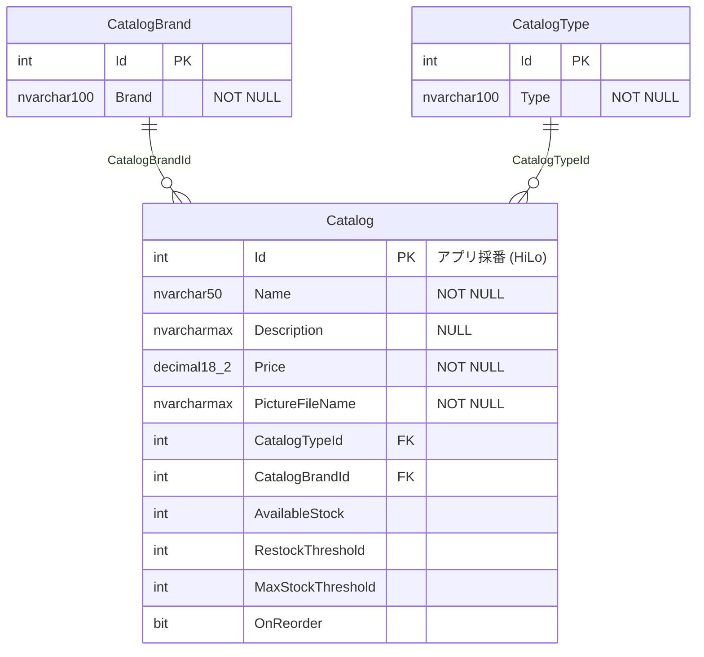

# 4. データ仕様（現行）

## 4.1 エンティティ

## 4.2 テーブル定義

**[現行]** 根拠: `Models/CatalogDBContext.cs`, `Models/*.cs`。型は EF6 + SQL Server の既定マッピングからの推定を含む（要実機確認）。

### `dbo.Catalog`（商品）

| 列 | 型 | NULL | 説明 | 画面ラベル |
|---|---|---|---|---|
| `Id` | int | NO | PK。DB 自動採番なし、HiLo で採番 | — |
| `Name` | nvarchar(50) | NO | 商品名 | Name |
| `Description` | nvarchar(max) | YES | 説明 | Description |
| `Price` | decimal(18,2) | NO | 価格（通貨は USD 表記） | Price |
| `PictureFileName` | nvarchar(max) | NO | 画像ファイル名（`/Pics/` 配下）。既定 `dummy.png` | Picture name |
| `CatalogTypeId` | int | NO | FK → `CatalogType.Id` | Type |
| `CatalogBrandId` | int | NO | FK → `CatalogBrand.Id` | Brand |
| `AvailableStock` | int | NO | 在庫数 | Stock |
| `RestockThreshold` | int | NO | 再発注点 | Restock |
| `MaxStockThreshold` | int | NO | 最大在庫数 | Max stock |
| `OnReorder` | bit | NO | 再発注中フラグ | （非表示） |

- `PictureUri` プロパティはモデルにあるが DB マッピング対象外（`Ignore`）かつ未使用
- FK は必須リレーションのため EF6 既定で ON DELETE CASCADE（ブランド・タイプ削除で商品も削除される。ただしアプリにブランド・タイプ削除機能はない）

### `dbo.CatalogBrand`（ブランド） / `dbo.CatalogType`（タイプ）

| 列 | 型 | NULL | 説明 |
|---|---|---|---|
| `Id` | int | NO | PK。EF6 の規約により IDENTITY 列になる（推定・要実機確認） |
| `Brand` / `Type` | nvarchar(100) | NO | 名称 |

### シーケンス

| 名前 | 定義 | 用途 |
|---|---|---|
| `dbo.catalog_hilo` | bigint, START 1, INCREMENT 10 | 商品 ID の HiLo 採番（実行時も使用） |
| `dbo.catalog_brand_hilo` | 同上 | 初期データ投入時にブランド ID の先頭値取得 |
| `dbo.catalog_type_hilo` | 同上 | 初期データ投入時にタイプ ID の先頭値取得 |

その他、EF6 が `dbo.__MigrationHistory` を作成する。

## 4.3 DB 初期化（`Models/Infrastructure/CatalogDBInitializer.cs`）

**[現行]** `UseMockData=false` のとき、最初の DB アクセスで実行。

1. DB `Microsoft.eShopOnContainers.Services.CatalogDb` が存在しなければ作成（`CreateDatabaseIfNotExists`）。既に存在する場合は何もしない（スキーマ変更・マイグレーションなし）
2. `Seed`:
   1. 3 つのシーケンス作成スクリプト（`Models/Infrastructure/*.Sequence.sql`）を実行
   2. タイプを登録（ID = `catalog_type_hilo` の次値から連番 → 1 始まり）
   3. ブランドを登録（ID = `catalog_brand_hilo` の次値から連番 → 1 始まり）
   4. 商品を登録（ID = HiLo ジェネレーター → 1 始まり）
   5. `UseCustomizationData=true` の場合のみ、`Pics` フォルダ内の全ファイルを削除し `Setup/CatalogItems.zip`（1〜12.png, dummy.png）を展開
3. データソースは `UseCustomizationData` で切替

| `UseCustomizationData` | データソース | 既定 |
|---|---|---|
| `false` | `PreconfiguredData`（コード内固定） | ✔ |
| `true` | `Setup/*.csv`（ファイルが無ければ `PreconfiguredData`） | |

## 4.4 初期データ

### `PreconfiguredData`（既定）

ブランド:

| Id | Brand |
|---|---|
| 1 | Azure |
| 2 | .NET |
| 3 | Visual Studio |
| 4 | SQL Server |
| 5 | Other |

タイプ:

| Id | Type |
|---|---|
| 1 | Mug |
| 2 | T-Shirt |
| 3 | Sheet |
| 4 | USB Memory Stick |

商品（全件 `AvailableStock=100`, `RestockThreshold=0`, `MaxStockThreshold=0`, `OnReorder=false`、`Description` = `Name`）:

| Id | Name | TypeId | BrandId | Price | Picture |
|---|---|---|---|---|---|
| 1 | .NET Bot Black Hoodie | 2 | 2 | 19.50 | 1.png |
| 2 | .NET Black & White Mug | 1 | 2 | 8.50 | 2.png |
| 3 | Prism White T-Shirt | 2 | 5 | 12.00 | 3.png |
| 4 | .NET Foundation T-shirt | 2 | 2 | 12.00 | 4.png |
| 5 | Roslyn Red Sheet | 3 | 5 | 8.50 | 5.png |
| 6 | .NET Blue Hoodie | 2 | 2 | 12.00 | 6.png |
| 7 | Roslyn Red T-Shirt | 2 | 5 | 12.00 | 7.png |
| 8 | Kudu Purple Hoodie | 2 | 5 | 8.50 | 8.png |
| 9 | Cup&lt;T&gt; White Mug | 1 | 5 | 12.00 | 9.png |
| 10 | .NET Foundation Sheet | 3 | 2 | 12.00 | 10.png |
| 11 | Cup&lt;T&gt; Sheet | 3 | 2 | 8.50 | 11.png |
| 12 | Prism White TShirt | 2 | 5 | 12.00 | 12.png |

商品の `CatalogTypeId` / `CatalogBrandId` は固定値で、ブランド・タイプが 1 始まりで採番される前提に依存している。

### `Setup/*.csv`（カスタマイズデータ）

- `CatalogBrands.csv`: ヘッダー `CatalogBrand`。7 件（上記 5 件 + `CatalogBrandTestOne`, `CatalogBrandTestTwo`）
- `CatalogTypes.csv`: ヘッダー `CatalogType`。6 件（上記 4 件 + `CatalogTypeTestOne`, `CatalogTypeTestTwo`）
- `CatalogItems.csv`: 13 件（上記 12 件相当 + `pepito`）。在庫数・`OnReorder` が CSV ごとに異なる（例: `.NET Black & White Mug` は在庫 89・再発注中）
  - 必須ヘッダー: `catalogtypename, catalogbrandname, description, name, price, picturefilename`（大文字小文字無視）
  - 任意ヘッダー: `availablestock, restockthreshold, maxstockthreshold, onreorder`
  - ブランド名・タイプ名で ID を解決。値は前後の空白と `"` を除去。価格はインバリアントカルチャで解析
  - 不正値は例外で初期化失敗

## 4.5 画像・静的ファイル

| パス | 内容 |
|---|---|
| `Pics/1.png`〜`12.png`, `Pics/dummy.png` | 商品画像（アプリ内の静的ファイルとして配信。URL `/Pics/{PictureFileName}`） |
| `images/brand.png`, `brand_dark.png`, `main_banner.png`, `main_footer_text.png` | レイアウト用画像 |
| `fonts/Montserrat-*` | Web フォント |
| `favicon.ico` | ファビコン |

画像は DB に保存されず、ファイル名のみ DB に保持する。
