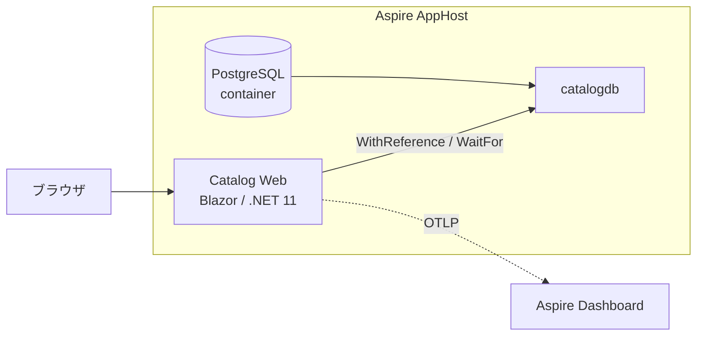

# 1. 移行先要件と対応方針

## 1.1 前提・スコープ

| 区分 | 内容 |
|---|---|
| **[要件]** 移行先スタック | .NET 11、Blazor、.NET Aspire、PostgreSQL |
| **[要件]** 第 1 ゴール | ローカルで `aspire run` を実行すると、AppHost・PostgreSQL・Web アプリが起動し、ブラウザから現行と同等のカタログ管理ができる |
| 対象外（次ステップ） | クラウドへのデプロイ、本番向け認証基盤、CI/CD |
| **[要件]** 機能範囲 | [現行] 機能 F-01〜F-05 を維持。F-06〜F-08 と未使用資産は [03-open-decisions](03-open-decisions.md) で決定 |

## 1.2 非機能要件（第 1 ゴール）

| ID | 要件 |
|---|---|
| NFR-01 | 前提ツールは .NET 11 SDK、Aspire CLI、コンテナランタイム（Docker Desktop / Podman）のみ。SQL Server・IIS・Visual Studio は不要 |
| NFR-02 | クリーンな環境で `aspire run` 1 コマンドで起動し、手動の DB 作成・SQL 実行を不要とする |
| NFR-03 | 初回起動時にスキーマ作成と初期データ投入が自動で行われる |
| NFR-04 | DB 接続情報は Aspire のリソース参照で注入し、パスワードをソースにコミットしない |
| NFR-05 | ログ・トレース・メトリクスを Aspire ダッシュボードで確認できる（OpenTelemetry、ServiceDefaults） |
| NFR-06 | Web アプリにヘルスチェックエンドポイントを持ち、ダッシュボードで正常状態を確認できる |
| NFR-07 | Windows / macOS / Linux で起動できる（OS 依存 API を使わない） |

## 1.3 構成案

想定ソリューション構成（プロジェクト名は [未確定]）:

| プロジェクト | 役割 |
|---|---|
| `*.AppHost` | Aspire AppHost。PostgreSQL コンテナ + DB リソース、Web アプリを定義 |
| `*.ServiceDefaults` | OpenTelemetry、ヘルスチェック、サービスディスカバリ、回復性の共通設定 |
| `*.Web` | Blazor Web アプリ（画面、サービス、EF Core） |
| （任意）`*.Tests` | サービス層・画面の自動テスト |

## 1.4 現行 → 移行先 対応表

| 現行 | 移行先 | 区分 |
|---|---|---|
| Web Forms ページ + コードビハインド | Blazor コンポーネント（`.razor`） | [要件] |
| Validator コントロール | DataAnnotations + `EditForm` / `DataAnnotationsValidator`（サーバー側でも必ず検証） | [要件] |
| `MapPageRoute` | `@page` ルート。現行 URL を維持（[02-acceptance-criteria](02-acceptance-criteria.md) AC-NAV） | [要件] |
| PostBack / ViewState | Blazor のフォーム送信またはインタラクティブレンダリング | [未確定] レンダリングモード（OD-01） |
| `Site.Master` | `MainLayout.razor` | [要件] |
| Autofac プロパティ注入 | ASP.NET Core 標準 DI（`@inject` / コンストラクター注入） | [要件] |
| `ICatalogService`（同期） | 非同期化した `ICatalogService`（`Task` ベース） | [要件] |
| EF6 + SQL Server LocalDB | EF Core + Npgsql（Aspire の PostgreSQL 統合） | [要件] |
| `CreateDatabaseIfNotExists` + Seed | 起動時のマイグレーション適用 + 初期データ投入（冪等） | [要件]、方式は [未確定]（OD-04） |
| SQL Server シーケンス + HiLo | PostgreSQL シーケンス（HiLo 継続）または IDENTITY | [未確定]（OD-03） |
| `decimal(18,2)` | `numeric(18,2)` | [要件] |
| `nvarchar(n)` / `nvarchar(max)` | `varchar(n)` / `text` | [要件] |
| log4net（ファイル） | `ILogger` → OpenTelemetry → Aspire ダッシュボード | [要件] |
| Application Insights | ローカルでは不要（デプロイ段階で Azure Monitor を検討） | [要件] |
| InProc セッション（フッター表示） | 下記 OD-06 で決定 | [未確定] |
| `UseMockData` | 下記 OD-05 で決定 | [未確定] |
| `Web.config` appSettings | `appsettings.json` / 環境変数 / AppHost からの注入 | [要件] |
| `Pics/`, `images/`, `fonts/`, CSS | `wwwroot/` 配下の静的ファイル（URL `/Pics/{name}` を維持） | [要件] |
| Bootstrap 4.3.1 + 独自 CSS | 独自 CSS（`site.css` 等）は移植。Bootstrap の版は [未確定]（OD-08） | |

## 1.5 PostgreSQL スキーマ案

**[要件]** テーブル・列の論理構造は [現行] と同一とする。物理名の表記（`Catalog` / `catalog` 等の大文字小文字、スネークケース化）は [未確定]（OD-09）。

| テーブル | 列 | 型 | 制約 |
|---|---|---|---|
| Catalog | Id | integer | PK |
| | Name | varchar(50) | NOT NULL |
| | Description | text | NULL 可 |
| | Price | numeric(18,2) | NOT NULL |
| | PictureFileName | text | NOT NULL, 既定 `dummy.png`（アプリ側） |
| | CatalogTypeId | integer | NOT NULL, FK |
| | CatalogBrandId | integer | NOT NULL, FK |
| | AvailableStock / RestockThreshold / MaxStockThreshold | integer | NOT NULL |
| | OnReorder | boolean | NOT NULL |
| CatalogBrand | Id / Brand | integer / varchar(100) | PK / NOT NULL |
| CatalogType | Id / Type | integer / varchar(100) | PK / NOT NULL |

初期データは [現行] の `PreconfiguredData`（ブランド 5、タイプ 4、商品 12）と同一とする（[04-data](../current-spec/04-data.md) 4.4）。

## 1.6 既知の不具合の扱い（推奨）

[06-known-issues](../current-spec/06-known-issues.md) のうち、以下は移行に合わせて修正することを推奨する（最終判断は OD-10）。

- 例外で HTTP 500 になるもの: KI-01, KI-02, KI-03, KI-07, KI-08
- データを壊すもの: KI-06
- セキュリティ: KI-09（Blazor の既定エンコードで自然に解消）
- 表示の不統一: KI-12
