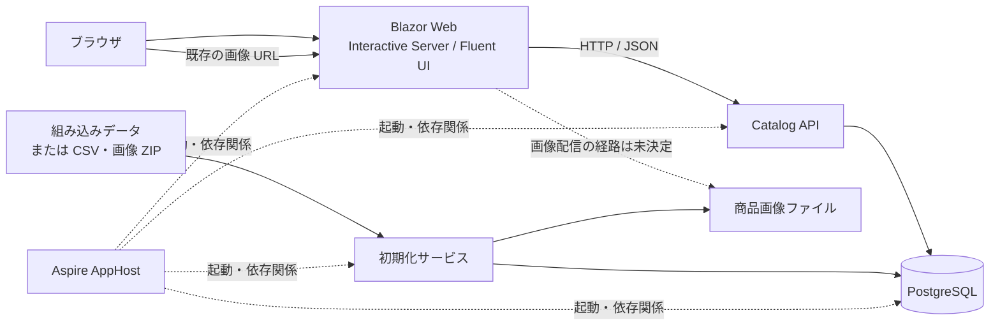

# 移行先仕様: 技術スペック

この文書は合意済みの移行先構成と不変条件を示す。実装済みの構成ではない。

## 構成と責務



| 要素 | 責務・境界 |
|---|---|
| Aspire AppHost | ローカルの PostgreSQL、初期化サービス、API、Web の起動と依存関係を管理する。利用者は `aspire run` で起動する |
| Blazor Web | 画面、既存ブラウザ URL、セッション情報、画像 URL を提供する。カタログの読み書きは API を経由し、PostgreSQL に直接接続しない |
| Catalog API | HTTP/JSON REST でカタログ操作を提供し、検証・同時更新の検知・データアクセスを担う |
| 初期化サービス | EF Core Migrations の適用と初回データ投入を行う。DB と画像の初期化が失敗した場合、成功したものとして扱わない |
| PostgreSQL | 商品・ブランド・タイプのカタログデータを保持する。通常の Aspire 停止・再起動ではデータを保持する |
| 画像ファイル | 商品画像の本体を保持し、既存の `/Pics/{name}` で表示できるようにする。配置と配信の具体的な方法は未決定 |

初期化が正常に終わる前に API が通常のカタログ操作を受け付けない。画像の配信に必要なアクセス経路は実装時に決定するが、Web が DB へ直接アクセスする構成にはしない。
サービス分離の判断は [ADR 0002](../adr/0002-service-boundaries.md) を参照する。

## ソリューションとプロジェクトの配置

移行先リポジトリに次の構成を設ける。これは設計であり、プロジェクトはまだ存在しない。[ADR 0005](../adr/0005-solution-layout.md) に選択理由を記録する。

```text
eShopModernizedWebFormsSolution.slnx
src/
  eShop.AppHost/                 Aspire の構成・起動
  eShop.ServiceDefaults/         共通のサービス設定
  eShop.Web/                     Blazor Web
  eShop.CatalogApi/              Catalog API
  eShop.CatalogData/             カタログ永続化・EF Core Migrations
  eShop.CatalogInit/             独立した初期化サービス
tests/
  eShop.UnitTests/
  eShop.CatalogApi.IntegrationTests/
  eShop.AppHost.Tests/
  eShop.BrowserTests/
docs/                            既存の仕様・ADR
```

`.slnx` に上記プロジェクトを登録する。初期スケルトンと AppHost のリソース配線があり、`CatalogData` に EF Core モデル、初回 Migration、マーカー付き組み込みシードを実装済みである。Catalog API のデータ操作エンドポイントとカタログ画面は未実装である。`CatalogData` は API と初期化サービスが共有する DB モデルと Migrations の所有者であり、API と初期化サービスから参照する。Web はこのライブラリを参照せず、カタログの読み書きには API を使う。画面と API の境界を DB モデルに結び付けず、共有 DTO ライブラリの追加は必要性が確認されるまで行わない。AppHost はサービスと DB の構成・依存関係を記述し、ServiceDefaults は適用するサービスに共通設定を提供する。初期化サービスは API と別の実行単位とする。

リポジトリルートで `aspire run` を実行する。AppHost が一つの場合、Aspire CLI は配下から発見できる。明示的に指定する場合は `aspire run --apphost src/eShop.AppHost/eShop.AppHost.csproj` とする。CLI の保存済み選択や複数 AppHost がある場合は明示指定を使う。ルートからの実動作は実装後に確認する。探索順は [Aspire CLI のリファレンス](https://aspire.dev/reference/cli/commands/aspire-run/) を参照。

## Web と UI

- ランタイムは .NET 11、UI は Blazor と `Microsoft.FluentUI.AspNetCore.Components` 5.0.1 を使用する。
- レンダリングモードは **Interactive Server を基本**とする。旧案の Static SSR 基本は採用しない。
- コンポーネントごとの適用、接続切断・再接続時の詳細、および .NET 11 との実動作は実装時に確認する。判断の背景は [ADR 0001](../adr/0001-blazor-rendering.md)。
- フッターのマシン名は API ホストではなく **Blazor Web ホスト**の名前とする。同一セッション中はその開始時刻を表示する。セッションの維持方法は [OD-06](https://github.com/runceel/eShopModernizedWebFormsSolution/issues/7) で決める。

## カタログデータ

- API は EF Core と Npgsql を使って PostgreSQL にアクセスし、スキーマを EF Core Migrations で管理する。
- 商品、ブランド、タイプとそれらの関連・業務項目は [現行データ仕様](../current-spec/04-data.md) を基準に維持する。商品画像のファイル名はカタログデータとして保持し、画像本体は DB に格納しない。
- 新規商品の ID は PostgreSQL IDENTITY で採番する。組み込み初期商品の ID は 1〜12 を維持し、初期投入・リセット後の新規 ID は既存 ID と衝突しないようにする。
- PostgreSQL の物理型は [OD-21](https://github.com/runceel/eShopModernizedWebFormsSolution/issues/22) の決定に従う。商品名は `varchar(50)`、説明と画像ファイル名は `text`、価格は `numeric(18,2)`、ブランド名とタイプ名は `varchar(100)` とする。
- アプリケーションのインメモリ・モックモードは設けない。テストの代替や実 DB の分離は[テスト方針](03-quality-and-operations.md#テストと対象外)に従う。

### PostgreSQL の物理命名

アプリが所有するテーブル・列・制約・インデックスは、英小文字の `snake_case` を用いる。PostgreSQL では引用符なしの識別子が小文字に正規化されるため、現行の PascalCase を引用して維持する案より、SQL での引用と大文字小文字の取り違えを減らせる。テーブル名は現行の単数形を保つ。

| 論理データ（現行名） | 移行先テーブル | 列の対応（現行名 → 物理名） |
|---|---|---|
| 商品 `Catalog` | `catalog` | `Id` → `id`、`Name` → `name`、`Description` → `description`、`Price` → `price`、`PictureFileName` → `picture_file_name`、`CatalogTypeId` → `catalog_type_id`、`CatalogBrandId` → `catalog_brand_id`、`AvailableStock` → `available_stock`、`RestockThreshold` → `restock_threshold`、`MaxStockThreshold` → `max_stock_threshold`、`OnReorder` → `on_reorder` |
| ブランド `CatalogBrand` | `catalog_brand` | `Id` → `id`、`Brand` → `brand` |
| タイプ `CatalogType` | `catalog_type` | `Id` → `id`、`Type` → `type` |

`PictureUri` は現行と同じく DB 列にしない。物理名の変更は論理項目、初期商品 ID、画像 URL、CSV の既存形式や画面表示名を変更するものではなく、API 契約も決めない。

アプリが定義するオブジェクトの名前は、主キーを `pk_<テーブル>`、外部キーを `fk_<従属テーブル>_<参照テーブル>_<従属列>`、インデックスを `ix_<テーブル>_<列>`、一意制約を `uq_<テーブル>_<列>`、チェック制約を `ck_<テーブル>_<意味>` とする。複数列は定義順に列名を `_` で連結する。例えば `pk_catalog`、`fk_catalog_catalog_brand_catalog_brand_id`、`ix_catalog_catalog_brand_id` とする。後続段階でこれらのオブジェクトを追加する場合も同じ命名規約を使う。PostgreSQL の識別子長上限（通常 63 バイト）を超える名前は衝突しないよう明示的に短縮し、同一スキーマ内の名前の衝突を検証する。

EF Core の共有永続化モデルにテーブル・列と、モデルが作成する制約・インデックスの物理名を明示して、API・初期化サービス・Migrations で同じマッピングを使う。Migrations の生成結果はレビューし、初回適用と後続変更の両方で名前を確認する。後日の改名はデータを失う削除・再作成と区別して移行を設計する。命名用プラグインへの依存は必須としない。EF Core の Migrations 履歴テーブルや PostgreSQL が管理する IDENTITY の内部シーケンスなど、フレームワーク・DB が管理する名前はこの規約の対象外とし、既定名を仮定してアプリから直接参照しない。

商品名・説明・価格・画像ファイル名はそれぞれ `varchar(50)`、nullable `text`、`numeric(18,2)`、`text` とする。ブランド名とタイプ名は `varchar(100)`。商品とブランド・タイプの外部キーは必須かつ `ON DELETE RESTRICT` とし、主キーと外部キー以外の二次インデックス、チェック制約、一意制約は作成しない。

現行 SQL Server の実データ移行は第 1 ゴールの対象外であり、既存 DB をこの命名に改名しない。将来の移行時には旧名と新名の対応、外部 SQL や参照先への影響を確認する。PostgreSQL の物理型・制約は [OD-21](https://github.com/runceel/eShopModernizedWebFormsSolution/issues/22) の決定に従う。DB スキーマ名や実データの移行方式は、この段階では追加で決定しない。Migrations 適用後、分離した PostgreSQL のカタログメタデータと照合して物理名・型を検証する。

## 起動時の初期化

1. AppHost は PostgreSQL の準備後、別の初期化サービスを実行する。
2. 初期化サービスはスキーマのマイグレーションを適用し、明示的な初期化マーカーがない DB に対して設定されたデータとマーカーを同一トランザクションで投入する。マーカーがないのにカタログ行が存在する DB は未初期化と推定せず、初期化を失敗させる。
3. 組み込みデータを選択した場合、現行と同じ商品 12 件・ブランド 5 件・タイプ 4 件を投入する。商品 ID は 1〜12 とする。
4. CSV・画像 ZIP を選択した場合、現行の CSV データ形式と画像を利用する。必要なファイルが不足・不正ならエラーとし、組み込みデータへの自動切替を行わない。
5. 初期化成功後に通常操作を開始する。**商品が 0 件になっただけでは未初期化とみなさず、再起動時に再投入しない。**

組み込みデータを既定とし、CSV・画像 ZIP は設定により選択する。CSV・画像 ZIP の実装は後続段階とする。初期化マーカーの具体的な保存形式は実装詳細とする。
データと初期化の判断は [ADR 0003](../adr/0003-persistence-and-initialization.md) を参照する。

## 明示的な DB リセット

ローカルのカタログ DB に対するリセットを Aspire のリソースコマンドとして提供する。CLI からの実行は `aspire resource <リソース> <コマンド>` の形式を想定し、リソース名・コマンド名・確認方法は未決定とする。

リセットは実行時点で有効な初期化設定に従い、組み込みデータまたは CSV・画像 ZIP を再投入する。通常起動や商品が 0 件になったことを理由に自動実行しない。
破壊的操作の確認、入力検証、画像の更新範囲、実行中の利用停止と失敗時の扱いは [品質・ローカル運用](03-quality-and-operations.md#db-リセット) に定める。

## 未決定の詳細

API のエンドポイント・応答形式の詳細とリセットの実装方式はそれぞれ関連 Issue で決定する。HTTP ステータスやデータベースの内部実装を、この文書から推測して確定扱いしない。
