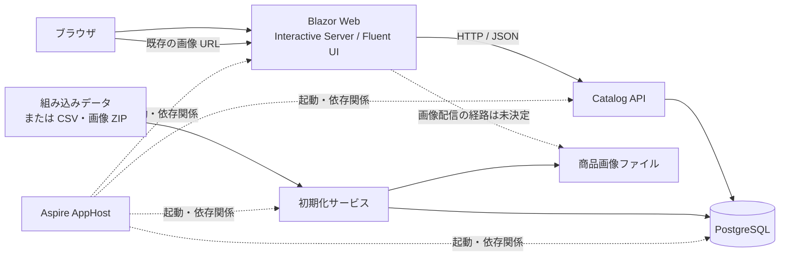

# 移行先仕様: 技術スペック

この文書は合意済みの移行先構成と不変条件を示す。実装済みの構成ではない。

## 構成と責務

| 要素 | 責務・境界 |
|---|---|
| Aspire AppHost | ローカルの PostgreSQL、初期化サービス、API、Web の起動と依存関係を管理する。利用者は `aspire run` で起動する |
| Blazor Web | 画面、既存ブラウザ URL、セッション情報、画像 URL を提供する。カタログの読み書きは API を経由し、PostgreSQL に直接接続しない |
| Catalog API | HTTP/JSON REST でカタログ操作を提供し、検証・同時更新の検知・データアクセスを担う |
| 初期化サービス | EF Core Migrations の適用と初回データ投入を行う。DB と画像の初期化が失敗した場合、成功したものとして扱わない |
| PostgreSQL | 商品・ブランド・タイプのカタログデータを保持する。通常の Aspire 停止・再起動ではデータを保持する |
| 画像ファイル | 商品画像の本体を保持し、既存の `/Pics/{name}` で表示できるようにする。配置と配信の具体的な方法は未決定 |

初期化が正常に終わる前に API が通常のカタログ操作を受け付けない。画像の配信に必要なアクセス経路は実装時に決定するが、Web が DB へ直接アクセスする構成にはしない。
サービス分離の判断は [ADR 0002](../adr/0002-service-boundaries.md) を参照する。

## Web と UI

- ランタイムは .NET 11、UI は Blazor と `Microsoft.FluentUI.AspNetCore.Components` 5.0.1 を使用する。
- レンダリングモードは **Interactive Server を基本**とする。旧案の Static SSR 基本は採用しない。
- コンポーネントごとの適用、接続切断・再接続時の詳細、および .NET 11 との実動作は実装時に確認する。判断の背景は [ADR 0001](../adr/0001-blazor-rendering.md)。
- フッターのマシン名は API ホストではなく **Blazor Web ホスト**の名前とする。同一セッション中はその開始時刻を表示する。セッションの維持方法は [OD-06](https://github.com/runceel/eShopModernizedWebFormsSolution/issues/7) で決める。

## カタログデータ

- API は EF Core と Npgsql を使って PostgreSQL にアクセスし、スキーマを EF Core Migrations で管理する。
- 商品、ブランド、タイプとそれらの関連・業務項目は [現行データ仕様](../current-spec/04-data.md) を基準に維持する。商品画像のファイル名はカタログデータとして保持し、画像本体は DB に格納しない。
- 新規商品の ID は PostgreSQL IDENTITY で採番する。組み込み初期商品の ID は 1〜12 を維持し、初期投入・リセット後の新規 ID は既存 ID と衝突しないようにする。
- 商品名や価格の制約・精度は現行 DB の仕様を基準とする。現行の `decimal(18,2)` 等には静的解析上の推定が含まれるため、PostgreSQL の物理型・命名と合わせて [OD-09](https://github.com/runceel/eShopModernizedWebFormsSolution/issues/10)、[OD-21](https://github.com/runceel/eShopModernizedWebFormsSolution/issues/22) で確認する。
- アプリケーションのインメモリ・モックモードは設けない。テスト用の代替手段は [OD-17](https://github.com/runceel/eShopModernizedWebFormsSolution/issues/18) で検討する。

## 起動時の初期化

1. AppHost は PostgreSQL の準備後、別の初期化サービスを実行する。
2. 初期化サービスはスキーマのマイグレーションを適用し、**未初期化の DB** に対して設定されたデータを投入する。
3. 組み込みデータを選択した場合、現行と同じ商品 12 件・ブランド 5 件・タイプ 4 件を投入する。商品 ID は 1〜12 とする。
4. CSV・画像 ZIP を選択した場合、現行の CSV データ形式と画像を利用する。必要なファイルが不足・不正ならエラーとし、組み込みデータへの自動切替を行わない。
5. 初期化成功後に通常操作を開始する。**商品が 0 件になっただけでは未初期化とみなさず、再起動時に再投入しない。**

組み込みデータを既定とし、CSV・画像 ZIP は設定により選択する。設定キー、ファイル配置、設定変更の反映方法と、未初期化を識別する具体的な仕組みは未決定である。
データと初期化の判断は [ADR 0003](../adr/0003-persistence-and-initialization.md) を参照する。

## 明示的な DB リセット

ローカルのカタログ DB に対するリセットを Aspire のリソースコマンドとして提供する。CLI からの実行は `aspire resource <リソース> <コマンド>` の形式を想定し、リソース名・コマンド名・確認方法は未決定とする。

リセットは実行時点で有効な初期化設定に従い、組み込みデータまたは CSV・画像 ZIP を再投入する。通常起動や商品が 0 件になったことを理由に自動実行しない。
破壊的操作の確認、入力検証、画像の更新範囲、実行中の利用停止と失敗時の扱いは [品質・ローカル運用](03-quality-and-operations.md#db-リセット) に定める。

## 未決定の詳細

API のエンドポイント・応答形式の詳細、DB 物理名・型、プロジェクト名・配置、リセットの実装方式はそれぞれ関連 Issue で決定する。HTTP ステータスやデータベースの内部実装を、この文書から推測して確定扱いしない。
