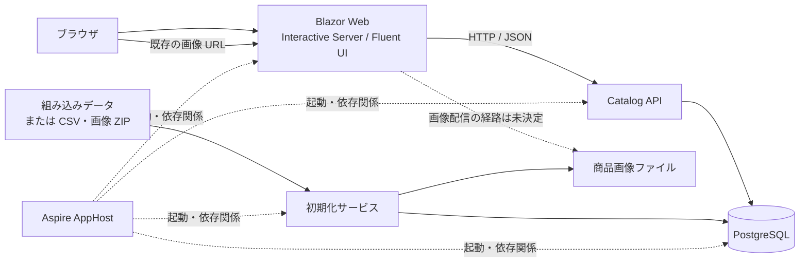

# 移行先仕様: 技術スペック

この文書は合意済みの移行先構成と不変条件を示す。実装済みの構成ではない。

## 構成と責務



| 要素 | 責務・境界 |
|---|---|
| Aspire AppHost | ローカルの PostgreSQL、初期化サービス、API、Web の起動と依存関係を管理する。利用者は `aspire run` で起動する |
| Blazor Web | 画面、既存ブラウザ URL、セッション情報、画像 URL を提供する。カタログの読み書きは API を経由し、PostgreSQL に直接接続しない |
| Catalog API | HTTP/JSON REST でカタログ操作を提供し、検証・同時更新の検知・データアクセスを担う |
| 初期化サービス | EF Core Migrations の適用と初回データ投入を行う。DB と画像の初期化が失敗した場合、成功したものとして扱わない |
| PostgreSQL | 商品・ブランド・タイプのカタログデータを保持する。通常の Aspire 停止・再起動ではデータを保持する |
| 画像ファイル | 商品画像の本体を保持し、既存の `/Pics/{name}` で表示できるようにする。配置と配信の具体的な方法は未決定 |

初期化が正常に終わる前に API が通常のカタログ操作を受け付けない。画像の配信に必要なアクセス経路は実装時に決定するが、Web が DB へ直接アクセスする構成にはしない。
サービス分離の判断は [ADR 0002](../adr/0002-service-boundaries.md) を参照する。

### Catalog API 契約

初回実装では `/api/catalog` と `/api/catalog/{id}` を公開する。一覧は 0 起点の `pageIndex`（既定 `0`）と `pageSize`（既定 `10`、有効範囲 `1..100`）を受け取り、ID 昇順で `items`、`pageIndex`、`pageSize`、`totalItems`、`totalPages` を返す。不正なページ指定は HTTP `400` とする。

作成要求は `name`、任意の `description`、`price`、`catalogBrandId`、`catalogTypeId`、`availableStock`、`restockThreshold`、`maxStockThreshold` を受け取る。Name は空白のみでなく最大 50 文字、価格は `0..1,000,000` かつ小数 2 桁以内、在庫項目は `0..10,000,000` の整数とし、ブランド・タイプ ID は実在する行を参照する。商品名の一意制約は設けない。作成は `Location`、強い ETag、`pictureFileName: "dummy.png"`、`onReorder: false` を伴う HTTP `201`、更新は HTTP `200`、削除は HTTP `204` とする。存在しない ID は HTTP `404` とする。更新可能な項目は作成要求と同じで、画像名と `OnReorder` は保持する。

詳細・作成・更新の成功応答は、プロバイダーが生成する現在の行バージョンを ETag で返す。更新には `If-Match` の強い引用符付き ETag を 1 つ必要とし、欠落は HTTP `428`、不正または弱い値は HTTP `400`、古い値は `code: "concurrency_conflict"` と `resourceId` を含む HTTP `409` とする。競合した更新は行を変更しない。検証・要求エラーは安定した `code` とフィールドエラー時の `errors` を含む `application/problem+json` を返す。状態変更を伴うクロスオリジン要求は HTTP `403` とする。API readiness は Migration 適用済みと初期化成功マーカーの両方を確認する。Development 環境では `/openapi/v1.json` で OpenAPI 文書を公開する。

## ソリューションとプロジェクトの配置

移行先リポジトリには次の構成を設ける。これは設計であり、プロジェクトの作成・起動検証が完了したことを示さない。[ADR 0005](../adr/0005-solution-layout.md) に選択理由を記録する。

```text
eShopModernizedWebFormsSolution.slnx
src/
  eShop.AppHost/
  eShop.ServiceDefaults/
  eShop.Web/
  eShop.CatalogApi/
  eShop.CatalogData/
  eShop.CatalogInit/
tests/
  eShop.UnitTests/
  eShop.CatalogApi.IntegrationTests/
  eShop.AppHost.Tests/
  eShop.BrowserTests/
docs/
```

`.slnx` に上記プロジェクトを登録する。`CatalogData` は API と初期化サービスが共有する DB モデルと EF Core Migrations の所有者であり、Web は参照しない。Web は HTTP/JSON REST で API に依存し、DB モデルに直接結び付かない。共有 DTO ライブラリの追加は必要性が確認されるまで行わない。AppHost はサービスと DB の構成・依存関係を記述し、ServiceDefaults は適用するサービスに共通設定を提供する。初期化サービスは API と別の実行単位とする。

リポジトリルートで `aspire run` を実行する。AppHost が一つの場合は配下から発見できる。明示的に指定する場合は `aspire run --apphost src/eShop.AppHost/eShop.AppHost.csproj` とする。CLI の保存済み選択や複数 AppHost がある場合は明示指定を使う。ルートからの実動作はプロジェクト作成後に確認する。

## ローカル起動の依存関係（OD-20）

AppHost は PostgreSQL の接続・クエリ可能な健康状態、今回の Migrations・初期化の正常終了、API readiness、Web readiness の順に通常利用を可能にする。プロセスの Running、固定時間の待機、過去の初期化成功記録だけを準備完了の根拠にしない。AppHost の依存待ちだけでは実行中の障害や単独起動を防げないため、API 自体も初期化・復旧状態を確認して操作を拒否する。

Web のブラウザー入口と Aspire Dashboard・管理用入口はループバックに限定する。Aspire のプロキシ／公開ポートを含め、API・DB は必要なサービス間通信だけとし、LAN やクラウドへ公開しない。localhost 限定・未認証でも CSRF 保護を省略しない。前提ツール、運用確認、観測と判断理由は[品質・ローカル運用](03-quality-and-operations.md#ローカル前提と確認od-20)と [ADR 0010](../adr/0010-local-aspire-operations.md) に定める。

## Web と UI

- ランタイムは .NET 11、UI は Blazor と `Microsoft.FluentUI.AspNetCore.Components` 5.0.1 を使用する。
- Bootstrap は UI 基盤として継続せず、Fluent UI のコンポーネントとレイアウトを基本とする。既存の独自 CSS・JavaScript は一律に移植せず、移行後も必要な役割があるものを個別に評価する。不要な Bootstrap・jQuery 依存や重複スタイルは残さない。通貨記号など、見た目以外の表示・操作の挙動は別の手段でも維持する。
- レンダリングモードは **Interactive Server を基本**とする。旧案の Static SSR 基本は採用しない。
- コンポーネントごとの適用、接続切断・再接続時の詳細、および .NET 11 との実動作は実装時に確認する。判断の背景は [ADR 0001](../adr/0001-blazor-rendering.md)。
- フッターのマシン名は API ホストではなく **Blazor Web ホスト**の名前とする。同一セッション中はその開始時刻を表示する。セッションの維持方法は [OD-06](https://github.com/runceel/eShopModernizedWebFormsSolution/issues/7) で決める。

### 画面ごとのレンダリングと操作（OD-01）

第 1 ゴールでは、次の全画面に合意済みの Interactive Server 基本方針を適用する。同じ画面の既存 URL 別名も同じ扱いとする。静的な内容であることと Static SSR の採用は区別し、About / Contact のための別モードや WebAssembly / Auto は導入しない。

| 画面 | レンダリング | フォーム・操作 |
|---|---|---|
| 商品一覧（ページ指定を含む） | Interactive Server | 一覧の表示・ページ移動と、登録・詳細・編集・削除への遷移 |
| 商品登録 | Interactive Server | 入力・検証後、API 経由で登録。成功後に一覧へ戻り、Cancel では保存しない |
| 商品詳細 | Interactive Server | 商品を表示し、対象商品の編集または一覧へ遷移。更新フォームは持たない |
| 商品編集 | Interactive Server | 現在値の入力・検証後、API 経由で更新。成功後に一覧へ戻り、Cancel では保存しない |
| 商品削除確認 | Interactive Server | 明示的な Delete 操作で API 経由の削除を行い、成功後に一覧へ戻る。表示や Cancel だけでは削除しない |
| About / Contact | Interactive Server | 現行の静的な内容を表示する。入力・更新フォームや新たなナビゲーションリンクは追加しない |

`/Pics/{name}` は画面ではなく画像の HTTP 配信であり、Blazor のレンダリングモードを適用しない。ID のない商品 `.aspx` URL の HTTP 500 応答もインタラクティブ画面で代替しない。対象 URL と例外は[画面・機能仕様](02-functional-spec.md#画面と-url)に従う。

登録・編集のフォーム操作と画面上の検証結果の反映は、Interactive Server のサーバー側で処理する。画面での入力チェックだけを保存の保証にせず、API でも入力を検証し、不正な入力では永続化しない。クライアント側の入力制約は補助であり、ブラウザー上の .NET 実行を前提にしない。検証エラーや API の失敗時は成功後の一覧遷移を行わず、失敗を利用者に通知する。検証項目・メッセージ・未決定の精度は[入力・検証](02-functional-spec.md#入力検証)に従い、ここでは追加の業務ルールを決めない。

画面間は Blazor のルーティングで遷移し、URL に含まれる商品 ID とページ指定を遷移先に引き継ぐ。通常の画面操作を Web Forms のポストバックや Static SSR のフォーム送信を前提とした構成にはしない。既存 URL への直接アクセスでも同じ画面を表示し、URL を別名へリダイレクトしない。成功後・Cancel / Back to list・ヘッダーからの遷移先は[共通表示・遷移](02-functional-spec.md#共通表示遷移)を維持する。回線・サーバー接続と再接続が必要な実行モデルであり、その詳細およびセッションの維持方法は別途扱う。

選定理由は、操作を伴う Fluent UI コンポーネントに必要なインタラクティビティを、サーバー側の実行モデルで提供するためである。Static SSR 基本案から変更した背景と接続管理のトレードオフは [ADR 0001](../adr/0001-blazor-rendering.md) に記録済みであり、この画面別整理はその判断を変更しない。

### プロジェクト構成・自動テストへの影響

- [OD-02（#3）](https://github.com/runceel/eShopModernizedWebFormsSolution/issues/3): UI とその実行状態は Blazor Web に置き、サーバー側で動く画面から HTTP/JSON REST の Catalog API を呼ぶ。Interactive Server を理由に Web から DB へ直接アクセスしない。別の WebAssembly クライアントプロジェクトを要求せず、[ADR 0002](../adr/0002-service-boundaries.md) の責務境界を維持する。[OD-16（#17）](https://github.com/runceel/eShopModernizedWebFormsSolution/issues/17)で決定したプロジェクト配置は本書の[ソリューション構成](#ソリューションとプロジェクトの配置)を参照する。
- [OD-17（#18）](https://github.com/runceel/eShopModernizedWebFormsSolution/issues/18): 初回 HTML 応答だけではフォーム・イベントの動作を確認できない。レンダリング方式から必要となる確認は、対話可能になってからの CRUD・画面上の検証・ページ移動・一覧復帰である。既存 URL の直接アクセス、About / Contact、画像、ID なし URL のステータスはブラウザー／HTTP でも確認する。クライアント検証を経由しない不正入力拒否も確認し、詳細な入力境界の全組合せを画面経由で重複させない。対象は[受け入れ基準 AC-08〜17](04-acceptance-criteria.md#画面互換性)と対応する。テスト層・ツール方針は [ADR 0006](../adr/0006-test-strategy.md) と[品質・ローカル運用](03-quality-and-operations.md#テストと対象外)に定める。OD-01 はレンダリング方式から導かれる確認範囲を示し、テスト方針全体を変更しない。

OD-01 はレンダリング方針の設計判断であり、各コンポーネントの選定、.NET 11 との互換性、接続切断・再接続の具体的な動作とテストの実装・実行が完了したことは意味しない。

## カタログデータ

API は EF Core と Npgsql で PostgreSQL にアクセスし、スキーマを EF Core Migrations で管理する。初期化サービスは同じ永続化モデルと Migration を使う。論理項目は[現行データ仕様](../current-spec/04-data.md)を基準に維持し、アプリが所有するテーブル・列・制約・インデックス名は英小文字 `snake_case` とする。既存 PascalCase を引用して維持せず、テーブル名は現行の単数形を保つ。

| 論理エンティティ | テーブル | 列 | PostgreSQL 型・NULL | 制約・対応 |
|---|---|---|---|---|
| 商品 | `catalog` | `id` | `integer GENERATED BY DEFAULT AS IDENTITY`, NOT NULL | PK `pk_catalog` |
| 商品 | `catalog` | `name` | `varchar(50)`, NOT NULL | 現行の最大長 |
| 商品 | `catalog` | `description` | `text`, NULL | 任意 |
| 商品 | `catalog` | `price` | `numeric(18,2)`, NOT NULL | 保存精度 |
| 商品 | `catalog` | `picture_file_name` | `text`, NOT NULL | 画像本体は DB に格納しない |
| 商品 | `catalog` | `catalog_type_id` | `integer`, NOT NULL | `catalog_type.id` への FK |
| 商品 | `catalog` | `catalog_brand_id` | `integer`, NOT NULL | `catalog_brand.id` への FK |
| 商品 | `catalog` | `available_stock` | `integer`, NOT NULL | 現行の整数項目 |
| 商品 | `catalog` | `restock_threshold` | `integer`, NOT NULL | 現行の整数項目 |
| 商品 | `catalog` | `max_stock_threshold` | `integer`, NOT NULL | 現行の整数項目 |
| 商品 | `catalog` | `on_reorder` | `boolean`, NOT NULL | 現行の真偽項目 |
| ブランド | `catalog_brand` | `id` | `integer GENERATED BY DEFAULT AS IDENTITY`, NOT NULL | PK `pk_catalog_brand` |
| ブランド | `catalog_brand` | `brand` | `varchar(100)`, NOT NULL | 現行の最大長 |
| タイプ | `catalog_type` | `id` | `integer GENERATED BY DEFAULT AS IDENTITY`, NOT NULL | PK `pk_catalog_type` |
| タイプ | `catalog_type` | `type` | `varchar(100)`, NOT NULL | 現行の最大長 |

商品からブランド・タイプへの外部キーは必須で、それぞれ `fk_catalog_catalog_type_catalog_type_id`、`fk_catalog_catalog_brand_catalog_brand_id` とする。参照先削除は `RESTRICT` とし、商品を連鎖削除しない。現行ソースで確認できない DB `CHECK` 制約や二次インデックスは追加せず、範囲検証は API の責務とする。

主キー・外部キー・インデックス・一意制約・チェック制約の名前はそれぞれ `pk_<table>`、`fk_<dependent-table>_<principal-table>_<dependent-column>`、`ix_<table>_<column>`、`uq_<table>_<column>`、`ck_<table>_<meaning>` とする。複数列名は定義順に連結する。PostgreSQL の識別子長上限（通常 63 バイト）を超える名前は衝突しないよう明示的に短縮する。これは作成するオブジェクトの命名規約であり、新しい制約・インデックスの追加を要求しない。EF Core の共有永続化モデルで物理名を明示し、Migration と実 DB メタデータを確認する。フレームワーク・DB 管理名は対象外とし、既定名を仮定して参照しない。

`price` は CLR `decimal`、現行モデルの `decimal(18,2)` コメント・小数 2 桁正規表現・最大値と EF6 Code First の既定精度を根拠に `numeric(18,2)` とする。生成済み SQL Server DDL はなく実 DB の列定義や直接 SQL 時の丸めは未確認のため、生成 Migration と隔離 PostgreSQL のメタデータを実装時に照合する。画面/API は en-US と 0〜1,000,000 の範囲を保ち、小数 2 桁を超える価格は保存前に拒否する。CSV 価格は invariant culture で解析し、スキーマで表せない値を丸めない。

商品 ID は PostgreSQL IDENTITY で採番し、組み込み商品 ID 1〜12 を維持する。組み込み・CSV 初期化やリセットで明示 ID を投入した後は、商品・ブランド・タイプの各 IDENTITY の次値を既存最大 ID より先へ調整する。通常の停止・再起動でシーケンスを初期値や現在の最大 ID に戻さない。欠番は許容し、連番や採番順を保証しない。失敗やロールバックで消費した値を回収しない。調整の失敗・中断時は整合性を確認・回復するまで通常操作を再開しない。

商品画像のファイル名はカタログに保持し、画像本体はファイルで管理する。初期データはブランド 5 件・タイプ 4 件・商品 12 件を含む。アプリケーションのインメモリ・モックモードは設けない。テスト層とテスト用 DB の分離は[テスト方針](03-quality-and-operations.md#テストと対象外)に従う。既存 PostgreSQL のスキーマ進化は Migrations で扱い、実際に次のスキーマ変更を加える際に旧 Migration からのアップグレードとデータ保持をテストする。SQL Server の実データ ETL は第 1 ゴールに含めない。

## 商品の同時更新制御（OD-13）

第 1 ゴールから商品単位の楽観的同時実行制御を適用する。Web はドラフトと編集開始時に取得したトークンを保持し、API は DB の原子的な条件付き更新で版の一致を保証する。古い版・欠落・不正なトークンは更新全体を拒否し、無条件更新にフォールバックしない。成功時に版を変更する。削除済み商品を古い更新で再作成せず、削除自体の競合契約はここでは定めない。

競合応答は成功応答と区別し、Web が競合・商品 ID を機械的に識別できるようにする。HTTP `409 Conflict` は候補だが、確定ステータス、識別子、フィールド名、トークン搬送方式は API 契約の設計時に定める。応答に最新データがあってもドラフトへ自動適用しない。新規商品・組み込み/CSV の投入商品も有効な版を持ち、CSV の業務形式にトークンを追加しない。

物理方式は独自 version 列と PostgreSQL のプロバイダー対応トークンを比較して選定し、特定の内部列や型を固定しない。原子的な一致判定、不一致時の非更新、ドラフト保護は実装詳細として緩和しない。[ADR 0008](../adr/0008-product-concurrency.md)を参照する。

## 起動時の初期化

1. AppHost は PostgreSQL の準備後に別の初期化サービスを実行し、正常終了を待って API の通常操作を可能にする。API を別経路で起動した場合も、今回の Migrations・初期化・更新成功を確認できなければ操作を受け付けない。
2. 初期化サービスは対象 DB の状態を変更前に確認し、同じ DB に対する重複実行を防ぐ。初回投入状態はカタログとともに永続化する明示的な初期化記録で識別する。未初期化とは、対象の管理領域が新規かつ空と確認できる状態に限る。商品数や Migrations 履歴だけでは判定しない。記録がない DB に既存カタログや判別不能な管理領域がある場合は、変更せず停止・通知する。
3. 状態確認後、初期化の開始を永続記録して EF Core Migrations を適用する。適用や確認の失敗時はエラーを通知し、API の通常操作を開始しない。
4. 初回投入では選択された入力を検証する。組み込みデータは商品 12 件・ブランド 5 件・タイプ 4 件、商品 ID 1〜12。CSV・画像 ZIP の不足・不正時は停止し、組み込みデータへ自動切替しない。
5. 初回投入の DB データと初期化成功記録は同一 DB トランザクションで確定する。画像配置と採番の整合性を確認してから成功記録を確定し、初期化サービスが正常終了する。

有効な成功記録があり未完了処理がない場合は、必要な Migrations 適用後も既存データを保持し、再投入しない。商品が 0 件になっただけでは再投入しない。DB、初期化記録、利用画像を通常停止・再起動後も保持する。過去の成功記録があってもリセットの失敗や状態不明を無視して通常操作を再開しない。

DB と画像は単一トランザクションではない。画像配置前に既存画像の誤上書き・削除を防ぎ、衝突や所有関係を判別できない場合は停止する。初期化途中の失敗・中断、記録と実状態の不整合、確認不能な状態では再シードせず、操作者へ通知して復旧確認まで通常操作を停止する。

組み込みデータを既定とし、CSV・画像 ZIP は AppHost 起動時の環境変数で選択する。入力場所は絶対パス、または AppHost プロジェクトディレクトリ基準の相対パスとし、作業ディレクトリに依存させない。初期化サービスから参照できる配置にし、リポジトリ外にも置けるようにする。現行形式の `CatalogTypes.csv`、`CatalogBrands.csv`、`CatalogItems.csv`、`CatalogItems.zip` を使う。タイプ・ブランド CSV のヘッダーは `CatalogType`、`CatalogBrand`。商品 CSV の必須列は `CatalogTypeName`、`CatalogBrandName`、`Description`、`Name`、`Price`、`PictureFileName`、任意列は `AvailableStock`、`RestockThreshold`、`MaxStockThreshold`、`OnReorder`。価格は invariant culture で解釈し、画像 ZIP は商品から参照するファイル名で対応付ける。現行の `1.png`〜`12.png`、`dummy.png` は例であり固定要件ではない。具体的な環境変数名と物理配置は実装時に定める。

設定変更は実行中プロセスへの反映を前提にしない。AppHost を停止し、変更した環境変数を設定したシェルで再起動後、既存 DB への反映は明示的なリセットで行う。通常の再起動だけでは再投入しない。初期化判断は [ADR 0003](../adr/0003-persistence-and-initialization.md) と [ADR 0007](../adr/0007-initialization-state.md)、入力判断は [ADR 0009](../adr/0009-customization-input.md) を参照する。

## 明示的な DB リセット

ローカルのカタログ DB に対するリセットを Aspire のリソースコマンドとして Dashboard と CLI に提供する。リソース／コマンド名は実装時に定め、実行中 AppHost の `aspire resource <リソース> --help` と `aspire resource <リソース> <コマンド> --help` で確認する。明示確認は両経路で渡せる必須入力として宣言し、実行側で検証する。`ConfirmationMessage` の表示だけを安全性の根拠にしない。

リセットは実行時点で有効な初期化設定に従い、組み込みデータまたは CSV・画像 ZIP を再投入する。通常起動や商品が 0 件になったことを理由に自動実行しない。
破壊的操作の確認、入力検証、画像の更新範囲、実行中の利用停止と失敗時の扱いは[品質・ローカル運用](03-quality-and-operations.md#db-リセット)に定める。

## 未決定の詳細

API のエンドポイント・応答形式の詳細、リセットの実装方式、設定キー、初期化状態の物理設計、画像の保存・配信経路は実装時に定める。HTTP ステータスや DB 内部実装を、この文書から推測して確定扱いしない。既存 SQL Server の実データ移行は第 1 ゴール対象外であり、物理名を理由に既存 DB を改名しない。
