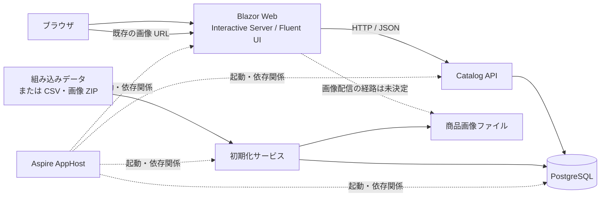

# 移行先仕様: 技術スペック

この文書は合意済みの移行先構成と不変条件を示す。実装済みの構成ではない。

## 構成と責務

| 要素 | 責務・境界 |
|---|---|
| Aspire AppHost | ローカルの PostgreSQL、初期化サービス、API、Web の起動と依存関係を管理する。利用者は `aspire run` で起動する |
| Blazor Web | 画面、既存ブラウザ URL、セッション情報、画像 URL を提供する。カタログの読み書きは API を経由し、PostgreSQL に直接接続しない |
| Catalog API | HTTP/JSON REST でカタログ操作を提供し、検証・同時更新の検知・データアクセスを担う |
| 初期化サービス | EF Core Migrations の適用と初回データ投入を行う。DB と画像の初期化が失敗した場合、成功したものとして扱わない |
| PostgreSQL | 商品・ブランド・タイプのカタログデータを保持する。通常の Aspire 停止・再起動ではデータを保持する |
| 画像ファイル | 商品画像の本体を保持し、既存の `/Pics/{name}` で表示できるようにする。配置と配信の具体的な方法は未決定 |

初期化が正常に終わる前に API が通常のカタログ操作を受け付けない。画像の配信に必要なアクセス経路は実装時に決定するが、Web が DB へ直接アクセスする構成にはしない。
サービス分離の判断は [ADR 0002](../adr/0002-service-boundaries.md) を参照する。

## Web と UI

- ランタイムは .NET 11、UI は Blazor と `Microsoft.FluentUI.AspNetCore.Components` 5.0.1 を使用する。
- レンダリングモードは **Interactive Server を基本**とする。旧案の Static SSR 基本は採用しない。
- コンポーネントごとの適用、接続切断・再接続時の詳細、および .NET 11 との実動作は実装時に確認する。判断の背景は [ADR 0001](../adr/0001-blazor-rendering.md)。
- フッターのマシン名は API ホストではなく **Blazor Web ホスト**の名前とする。同一セッション中はその開始時刻を表示する。セッションの維持方法は [OD-06](https://github.com/runceel/eShopModernizedWebFormsSolution/issues/7) で決める。

### 画面ごとのレンダリングと操作（OD-01）

第 1 ゴールでは、次の全画面に合意済みの Interactive Server 基本方針を適用する。同じ画面の既存 URL 別名も同じ扱いとする。静的な内容であることと Static SSR の採用は区別し、About / Contact のための別モードや WebAssembly / Auto は導入しない。

| 画面 | レンダリング | フォーム・操作 |
|---|---|---|
| 商品一覧（ページ指定を含む） | Interactive Server | 一覧の表示・ページ移動と、登録・詳細・編集・削除への遷移 |
| 商品登録 | Interactive Server | 入力・検証後、API 経由で登録。成功後に一覧へ戻り、Cancel では保存しない |
| 商品詳細 | Interactive Server | 商品を表示し、対象商品の編集または一覧へ遷移。更新フォームは持たない |
| 商品編集 | Interactive Server | 現在値の入力・検証後、API 経由で更新。成功後に一覧へ戻り、Cancel では保存しない |
| 商品削除確認 | Interactive Server | 明示的な Delete 操作で API 経由の削除を行い、成功後に一覧へ戻る。表示や Cancel だけでは削除しない |
| About / Contact | Interactive Server | 現行の静的な内容を表示する。入力・更新フォームや新たなナビゲーションリンクは追加しない |

`/Pics/{name}` は画面ではなく画像の HTTP 配信であり、Blazor のレンダリングモードを適用しない。ID のない商品 `.aspx` URL の HTTP 500 応答もインタラクティブ画面で代替しない。対象 URL と例外は[画面・機能仕様](02-functional-spec.md#画面と-url)に従う。

登録・編集のフォーム操作と画面上の検証結果の反映は、Interactive Server のサーバー側で処理する。画面での入力チェックだけを保存の保証にせず、API でも入力を検証し、不正な入力では永続化しない。クライアント側の入力制約は補助であり、ブラウザー上の .NET 実行を前提にしない。検証エラーや API の失敗時は成功後の一覧遷移を行わず、失敗を利用者に通知する。検証項目・メッセージ・未決定の精度は[入力・検証](02-functional-spec.md#入力検証)に従い、ここでは追加の業務ルールを決めない。

画面間は Blazor のルーティングで遷移し、URL に含まれる商品 ID とページ指定を遷移先に引き継ぐ。通常の画面操作を Web Forms のポストバックや Static SSR のフォーム送信を前提とした構成にはしない。既存 URL への直接アクセスでも同じ画面を表示し、URL を別名へリダイレクトしない。成功後・Cancel / Back to list・ヘッダーからの遷移先は[共通表示・遷移](02-functional-spec.md#共通表示遷移)を維持する。回線・サーバー接続と再接続が必要な実行モデルであり、その詳細およびセッションの維持方法は別途扱う。

選定理由は、操作を伴う Fluent UI コンポーネントに必要なインタラクティビティを、サーバー側の実行モデルで提供するためである。Static SSR 基本案から変更した背景と接続管理のトレードオフは [ADR 0001](../adr/0001-blazor-rendering.md) に記録済みであり、この画面別整理はその判断を変更しない。

### プロジェクト構成・自動テストへの影響

- [OD-02（#3）](https://github.com/runceel/eShopModernizedWebFormsSolution/issues/3): UI とその実行状態は Blazor Web に置き、サーバー側で動く画面から HTTP/JSON REST の Catalog API を呼ぶ。Interactive Server を理由に Web から DB へ直接アクセスしない。別の WebAssembly クライアントプロジェクトを要求せず、[既定のプロジェクト配置](#ソリューションとプロジェクトの配置)と [ADR 0002](../adr/0002-service-boundaries.md) の責務境界を維持する。
- [OD-17（#18）](https://github.com/runceel/eShopModernizedWebFormsSolution/issues/18): 初回の HTML 応答だけではフォーム・イベントの動作を確認できない。既定の Playwright for .NET による限定ブラウザーテストで、インタラクティブな操作が可能になってから CRUD・画面上の検証・ページ移動・一覧復帰を確認する。既存 URL の直接アクセス、About / Contact、画像、ID なし URL のステータスはブラウザー／HTTP でも確認する。検証の詳細とクライアント検証を経由しない不正入力拒否は単体・API 統合に置き、全組合せを E2E に重複させない。[ADR 0006](../adr/0006-test-strategy.md)、[テスト方針](03-quality-and-operations.md#テストと対象外)と AC-08〜17 の[層別対応](04-acceptance-criteria.md#自動テストの対応)に従う。

OD-01 はレンダリング方針の設計判断であり、各コンポーネントの選定、.NET 11 との互換性、接続切断・再接続の具体的な動作とテストの実装・実行が完了したことは意味しない。

## カタログデータ

- API は EF Core と Npgsql を使って PostgreSQL にアクセスし、スキーマを EF Core Migrations で管理する。
- 商品、ブランド、タイプとそれらの関連・業務項目は [現行データ仕様](../current-spec/04-data.md) を基準に維持する。商品画像のファイル名はカタログデータとして保持し、画像本体は DB に格納しない。
- 新規商品の ID は PostgreSQL IDENTITY で採番する。組み込み初期商品の ID は 1〜12 を維持し、初期投入・リセット後の新規 ID は既存 ID と衝突しないようにする。
- 商品名や価格の制約・精度は現行 DB の仕様を基準とする。現行の `decimal(18,2)` 等には静的解析上の推定が含まれるため、PostgreSQL の物理型・命名と合わせて [OD-09](https://github.com/runceel/eShopModernizedWebFormsSolution/issues/10)、[OD-21](https://github.com/runceel/eShopModernizedWebFormsSolution/issues/22) で確認する。
- アプリケーションのインメモリ・モックモードは設けない。テスト用の代替手段は [OD-17](https://github.com/runceel/eShopModernizedWebFormsSolution/issues/18) で検討する。

## 起動時の初期化

1. AppHost は PostgreSQL の準備後、別の初期化サービスを実行する。
2. 初期化サービスはスキーマのマイグレーションを適用し、**未初期化の DB** に対して設定されたデータを投入する。
3. 組み込みデータを選択した場合、現行と同じ商品 12 件・ブランド 5 件・タイプ 4 件を投入する。商品 ID は 1〜12 とする。
4. CSV・画像 ZIP を選択した場合、現行の CSV データ形式と画像を利用する。必要なファイルが不足・不正ならエラーとし、組み込みデータへの自動切替を行わない。
5. 初期化成功後に通常操作を開始する。**商品が 0 件になっただけでは未初期化とみなさず、再起動時に再投入しない。**

組み込みデータを既定とし、CSV・画像 ZIP は設定により選択する。設定キー、ファイル配置、設定変更の反映方法と、未初期化を識別する具体的な仕組みは未決定である。
データと初期化の判断は [ADR 0003](../adr/0003-persistence-and-initialization.md) を参照する。

## 明示的な DB リセット

ローカルのカタログ DB に対するリセットを Aspire のリソースコマンドとして提供する。CLI からの実行は `aspire resource <リソース> <コマンド>` の形式を想定し、リソース名・コマンド名・確認方法は未決定とする。

リセットは実行時点で有効な初期化設定に従い、組み込みデータまたは CSV・画像 ZIP を再投入する。通常起動や商品が 0 件になったことを理由に自動実行しない。
破壊的操作の確認、入力検証、画像の更新範囲、実行中の利用停止と失敗時の扱いは [品質・ローカル運用](03-quality-and-operations.md#db-リセット) に定める。

## 未決定の詳細

API のエンドポイント・応答形式の詳細、DB 物理名・型、プロジェクト名・配置、リセットの実装方式はそれぞれ関連 Issue で決定する。HTTP ステータスやデータベースの内部実装を、この文書から推測して確定扱いしない。
